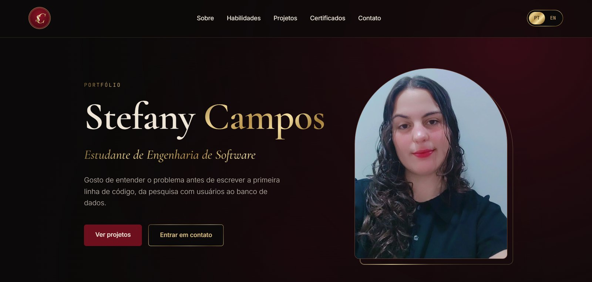

# Stefany Campos · Portfólio

Portfólio pessoal de **Stefany Campos**, estudante de Engenharia de Software no Centro Universitário UDF, em busca do primeiro estágio em tecnologia em Brasília (DF) ou Valparaíso (GO).

Feito do zero, sem frameworks, com **HTML, CSS e JavaScript puros**.



## Seções

- **Início:** apresentação, foto e acesso rápido aos projetos e ao contato
- **Sobre:** quem eu sou e download do currículo em PT ou EN
- **Habilidades:** três pilares, Interface, Dados e Código
- **Projetos:** mosaico com destaque e detalhes de cada projeto em uma janela modal
- **Certificados:** carrossel horizontal com visualização ampliada
- **Contato:** e-mail com botão de copiar, LinkedIn e GitHub

## Destaques

- **Português e inglês:** troca de idioma na hora, e a escolha fica salva para a próxima visita
- **Fundo que muda com a rolagem:** a luz vinho muda de lugar e de tom ao longo da página, desenhada em `<canvas>`
- **Fio de ouro no cursor:** um rastro dourado e suave que segue o mouse
- **Detalhes em ouro:** reflexo que percorre a moldura da foto e brilho que passa pelo nome
- **Animações ao rolar:** as seções aparecem com `IntersectionObserver`
- **Responsivo:** o layout se adapta a celular, tablet e computador
- **Acessível:** HTML semântico, navegação por teclado, `aria-*` e suporte a `prefers-reduced-motion`

## Tecnologias

| Tecnologia | Uso |
|---|---|
| HTML5 | Estrutura semântica, `<dialog>` para os modais |
| CSS3 | Variáveis, Grid, Flexbox, `@property`, `conic-gradient`, `mask`, media queries |
| JavaScript | Troca de idioma, modais, carrossel, animações em `<canvas>`, `localStorage` |
| Git e GitHub | Versionamento |

## Estrutura

```
portfolio/
├── index.html
├── css/
│   └── style.css
├── js/
│   └── script.js
├── img/          # foto, logo, imagens dos projetos e certificados
└── arquivos/     # currículos em PT e EN
```

## Como rodar

1. Clone o repositório:
   ```bash
   git clone https://github.com/stefanycamposofc-oss/portfolio.git
   ```
2. Abra a pasta no VS Code.
3. Clique com o botão direito em `index.html` e escolha **Open with Live Server**.

## Contato

- **E-mail:** stefany.camposofc@gmail.com
- **LinkedIn:** [linkedin.com/in/stefany--campos](https://www.linkedin.com/in/stefany--campos/)
- **GitHub:** [github.com/stefanycamposofc-oss](https://github.com/stefanycamposofc-oss)
